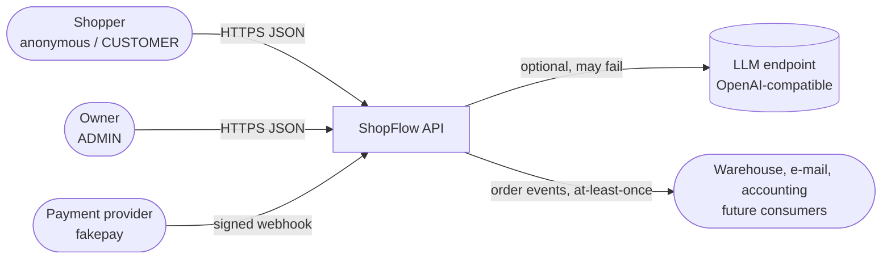
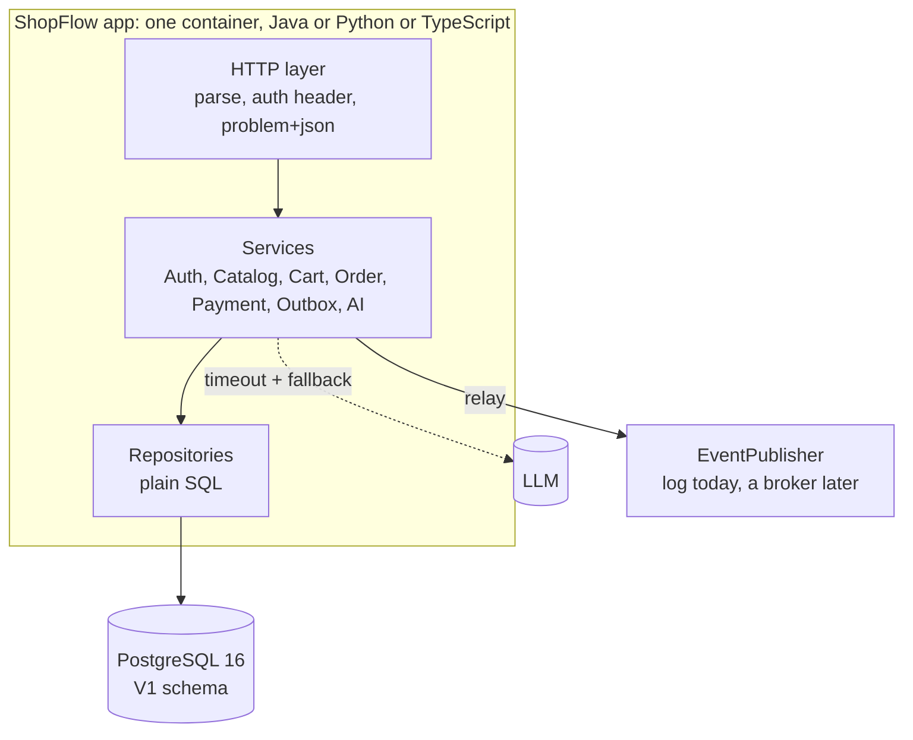
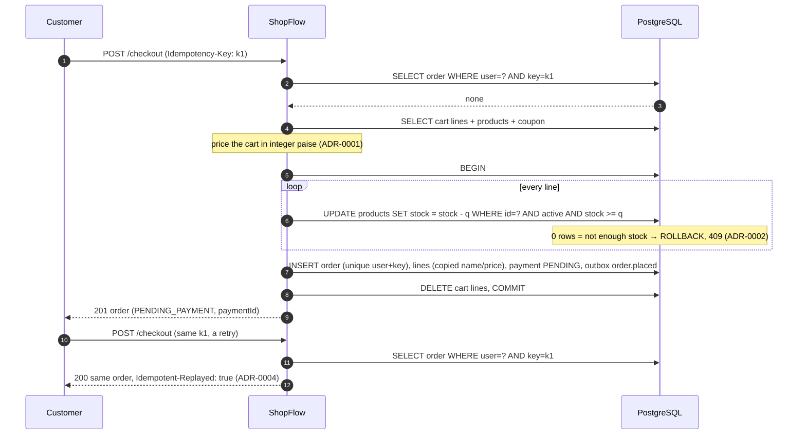
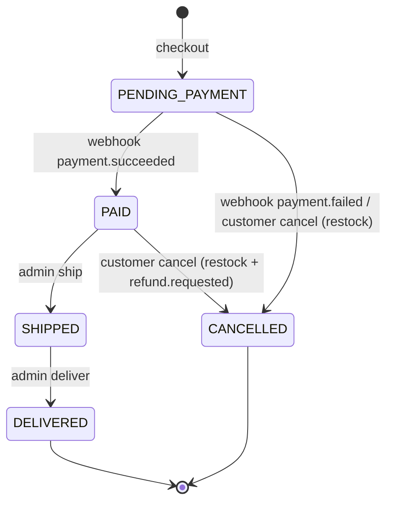
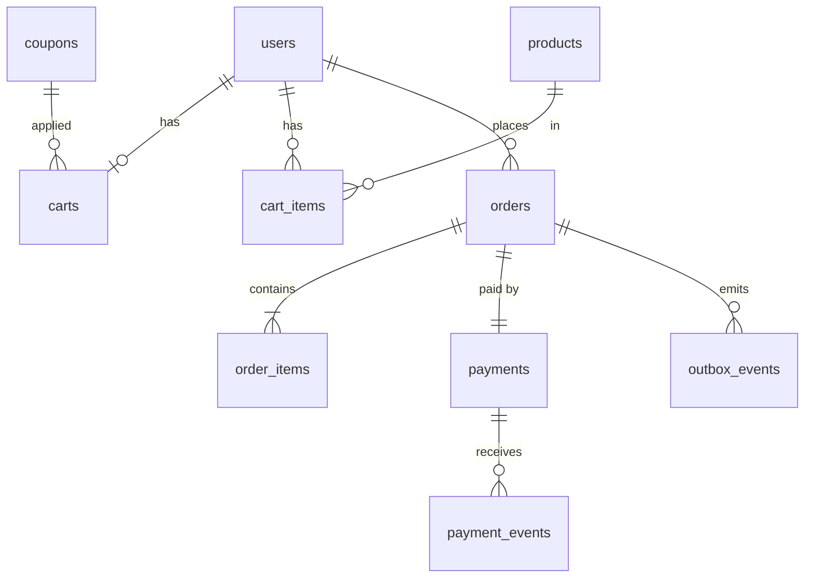

# ShopFlow architecture

> Reference version (tag `phase-2-end`). Diagrams are [Mermaid](https://mermaid.js.org/); GitHub renders
> them. Every track implements the same design; only the framework differs.

## 1. Context diagram


## 2. Container diagram


* **On the request path and must work:** app + PostgreSQL. `/health` reports the database.
* **On the request path but allowed to fail:** the LLM (description drafts, search assist). Every call
  has a timeout and falls back to the offline template/rules. It is **never** called during checkout.
* **Off the request path:** event publishing. Order changes only *write* outbox rows; the relay
  publishes them later (ADR-0005).
* Services are framework-free (plain classes with injected repositories and a clock), so unit tests
  run against an in-memory store in milliseconds and the same rules apply in all three tracks.

## 3. Checkout sequence

Two customers racing for the last unit both reach step 6; PostgreSQL row locks serialise the two
`UPDATE`s, the second one sees `stock = 0`, matches 0 rows and its whole transaction rolls back.
Two *identical* requests racing (double click) both miss step 2; the unique `(user_id,
idempotency_key)` constraint lets one INSERT win, and the loser returns the winner's order.

## 4. Payment webhook sequence
```mermaid
sequenceDiagram
  autonumber
  participant P as fakepay
  participant A as ShopFlow
  participant DB as PostgreSQL
  P->>A: POST /payments/webhook {id: evt_1, type: payment.succeeded, paymentId}<br/>X-Signature: sha256=HMAC(raw body)
  Note over A: verify HMAC in constant time → else 401 invalid-signature
  A->>DB: BEGIN; INSERT payment_events (evt_1) ON CONFLICT DO NOTHING
  A->>DB: UPDATE orders SET status='PAID' WHERE id=? AND status='PENDING_PAYMENT'
  A->>DB: UPDATE payments SET status='SUCCEEDED'; INSERT outbox order.paid; COMMIT
  A-->>P: 200 {status: processed}
  P->>A: same evt_1 again (the provider retries)
  A-->>P: 200 {status: duplicate} (nothing changes)
```
A success that arrives after the customer cancelled keeps the order CANCELLED and writes a
`refund.requested` event instead (the money must go back). A `payment.failed` cancels the order and
puts the stock back.

## 5. Order state machine

Every transition is a compare-and-set (`UPDATE … WHERE id = ? AND status = <from>`), so a cancel and a
webhook racing for the same order cannot both win; the loser gets `409 invalid-transition`. Each
transition writes its outbox event in the same transaction.

## 6. Data model
See [`db/migrations/V1__init.sql`](db/migrations/V1__init.sql).



| Table | Notes |
|---|---|
| `users` | unique lower-case e-mail, role CHECK (CUSTOMER, ADMIN) |
| `products` | `price_paise BIGINT`, `CHECK (stock >= 0)` (the last line of defence against overselling), `version` for optimistic locking, generated `search_vector` + GIN index, partial index on active products |
| `coupons` | PERCENT (1–90, optional cap) or FLAT (paise); seeded demo codes |
| `carts`, `cart_items` | one cart per user; quantity CHECK 1–10 |
| `orders` | money columns + `CHECK (total = subtotal − discount + shipping)`, unique `(user_id, idempotency_key)`, indexes for "my orders" and "orders by status" |
| `order_items` | SKU, name and unit price **copied**: editing a product never changes a past order |
| `payments`, `payment_events` | one payment per order; every processed webhook event id (primary key = de-duplication) |
| `outbox_events` | JSONB payload, `published_at` NULL until relayed; partial index on pending rows |

## 7. Contract map (OpenAPI path → requirement)
| Path | FR |
|---|---|
| `/api/v1/auth/*`, `/api/v1/me` | FR-1, FR-2, FR-3 |
| `/api/v1/products`, `/api/v1/products/{sku}`, `/api/v1/categories` | FR-4, FR-5 |
| `/api/v1/products/{sku}/stock` | FR-6 |
| `/api/v1/cart`, `/api/v1/cart/items/{sku}`, `/api/v1/cart/coupon` | FR-8, FR-9, FR-10 |
| `/api/v1/checkout` | FR-11 |
| `/api/v1/orders*`, `/api/v1/admin/orders*` | FR-12 |
| `/api/v1/payments/webhook` | FR-13 |
| `/api/v1/admin/outbox*` | FR-14 |
| `/api/v1/products/{sku}/description-draft`, `/api/v1/search/assist` | FR-15, FR-16 |
| `/health` | FR-18 |

## 8. Key decisions
* [ADR-0001](adr/0001-money-as-integer-paise.md) Money as integer paise
* [ADR-0002](adr/0002-guarded-stock-decrement.md) Guarded stock decrement instead of read-check-write
* [ADR-0003](adr/0003-optimistic-locking-for-products.md) Optimistic locking for product edits
* [ADR-0004](adr/0004-idempotent-checkout-and-webhook-dedup.md) Idempotent checkout and webhook de-duplication
* [ADR-0005](adr/0005-transactional-outbox.md) Transactional outbox for order events
